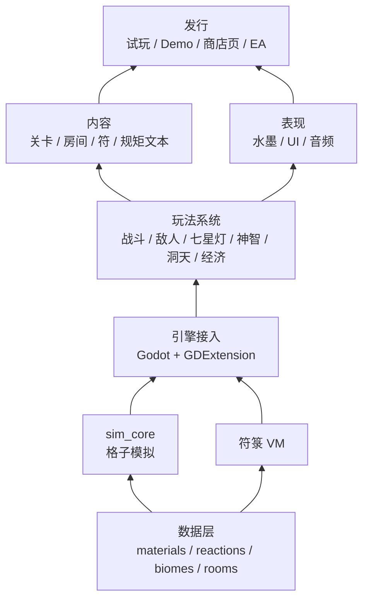
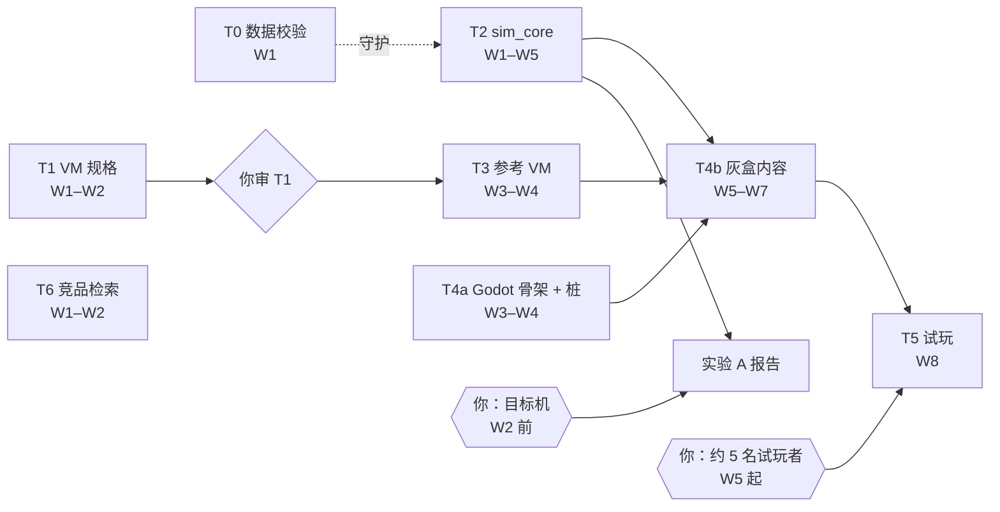

# 03 开发路线图：分几步、怎么排、依赖怎么界定

> 状态：**生效**｜制定：2026-11-15｜每个阶段门评审时更新
> 依据：`docs/01-decision-twist.md`（D1–D5）、`docs/02-m0-plan.md`、设计原文 4.9 / 第五章、批注 C50 / C52 / C53。
> 本文管"全局怎么走"；当前阶段的具体任务看 `docs/0x-mN-plan.md`（M0 即 `02`）。

## 结论

1. **分 5 步，每步只回答一个问题，以一道门结束**：M0 能不能做 → M1 一层好不好玩 → M2 给外人看行不行（垂直切片 + Demo）→ M3 撑得起 EA 吗 → M4 EA 到 1.0。下一步的生产工作，只在上一道门通过后开始。
2. **借三个现成流程**：阶段门（定"什么时候停下来判断"）+ 风险驱动（定"先做什么"）+ 固定时间、可变范围（定"做不完怎么办"）。另外用"契约先行"约束 AI 实现。
3. **依赖只连"产物"，不连"事情"**：任务 A 依赖 B，当且仅当 A 要读 B 产出的某个文件。依赖分四类：硬、软（可打桩）、决策、门。乱麻的根源是把这四类混在一起。

---

## 1. 五步总览

| 阶段 | 只回答一个问题 | 范围 | 退出门（通过才进下一步） | 量级（占位，不承诺） |
|---|---|---|---|---|
| **M0 验证** | 能不能做？ | 三个实验：A 模拟性能、B 符语义、C 10 分钟手感（见 02） | A / B / C 达标（01 D4） | 8 周（已定，至 2027-01-10） |
| **M1 MVP** | 一层好不好玩？ | 矿井 1 层 + 洞天 + 符箓三段式 + 3 种法器 + 七星灯 + 神智与可逆入魔；灰盒美术 | 一局 20–30 分钟可从开局玩到死亡 / 打过旱魃；外部试玩多数人主动想再来一局（人数与比例在 M1 计划里定） | 3–5 个月 |
| **M2 垂直切片 + Demo** | 给外人看行不行？ | 2 层 + 阴面或祠堂怨灵（二选一先做）+ 水墨后处理 + 存档；Steam 商店页 | 前 10 分钟能看见符箓三段式 UI / 七星灯 / 水墨画面中至少两样（设计原文风险 2）；Demo 外部反馈达标；商店页上线 | 4–6 个月 |
| **M3 生产到 EA** | 内容撑得起 EA 吗？ | 4 层 + 鬼市 + 纸扎 + 入魔深层内容 + 双货币；平衡与稳定性 | 内容量与崩溃率达 EA 标准（M3 计划里定） | 6–12 个月 |
| **M4 EA → 1.0** | 玩家要什么？ | 按 EA 反馈迭代；命格三选一回归（D5）；Mod 接口 | 1.0 范围清单完成 | 6–12 个月 |

- 量级是数量级占位，用来排先后，**不是承诺**。每道门评审时，按上一阶段实测速度重估下一阶段（D4）。
- 和设计原文 4.9 的差别：原文 M0 含刚体碎裂、按 4–6 人排期；这里 M0 只做三个实验，M1 先做一层的完整循环，垂直切片挪到 M2（与原文 M2 一致）。
- 每个阶段的"不做"清单沿用 01 D4：阴面、纸扎、鬼市、祠堂怨灵、入魔深层内容、双货币、像素刚体碎裂都在 M2 之前不做。

## 2. 借鉴的流程

| 流程 | 拿来做什么 | 不拿什么 |
|---|---|---|
| **阶段门**（Stage-Gate；游戏业常见的原型 → 垂直切片 → Alpha → Beta） | 每个阶段结尾一次 go / no-go，标准事先写死 | 大团队的 Alpha / Beta 文书流程 |
| **风险驱动**（Boehm 螺旋模型） | 每个阶段先做最可能让项目死掉的事：M0 是性能和语义，M1 是"好不好玩"，M2 是"第一眼像不像 Noita 换皮" | 每圈都做完整的形式化风险分析 |
| **固定时间、可变范围**（Basecamp《Shape Up》的"胃口"） | 每个阶段、每个任务先定"最多花多久"；到点做不完就砍范围，不延期；阶段末留 1 周冷却（修 bug、写报告、做下一份计划） | 固定 6 周一轮 |
| **契约先行**（规格 + 用例先于实现，近似 TDD） | AI 写的代码难以自证正确（批注 C46）：先写规格和测试用例，你审规格，AI 按用例实现 | 对所有代码都强制先写测试 |
| **看板 WIP 上限** | 限制同时进行的事，见 §3.5 | 看板工具本身；仓库里的 md 就够 |
| **关键路径法** | 找出最长的依赖链，盯住它；其他任务有余量 | 精确到天的甘特图 |
| **EA 公开开发**（Noita、Hades、Slay the Spire 都走过 EA） | M4 用 EA 获取反馈、分摊内容量 | — |

## 3. 依赖怎么界定

### 3.1 一条规则：依赖只连产物

每个任务写清**输入**（读哪些文件）和**输出**（产出哪些文件）。

- A 依赖 B ⟺ A 的输入里有 B 的输出。
- "B 做完了 A 才好做"这种感觉，如果说不出是哪个文件，就**不是依赖**，可以并行。
- 输出必须是仓库里的文件（规格、数据、代码、报告），不能是"某人知道了"。

### 3.2 四类依赖

| 类型 | 含义 | 处理方式 | M0 的例子 |
|---|---|---|---|
| **硬依赖** | 必须拿到真实产物才能开工 | 排在后面；盯关键路径 | T3 参考 VM ← T1 的 30 条用例 |
| **软依赖** | 有了更好，没有可以先打桩 | 先按契约写桩，真实产物到了再替换 | T4 灰盒 ← T2 `sim_core`：可先用假模拟搭 Godot 骨架 |
| **决策依赖** | 需要你拍板 | 写进当期计划的"需要你决定"，标截止日 | T3 ← 你审定 T1 规格 |
| **门依赖** | 需要上一阶段的结论 | 下一阶段的生产工作不提前做；允许 ≤ 2 天的探路实验（spike），要写 log | M1 全部任务 ← 2027-01-10 评审 |

外部依赖（硬件、试玩者）按决策依赖处理：落在你身上，要有截止日。

### 3.3 契约：大多数依赖都指向它们

契约 = 多个任务共同读写的接口文件。先冻结 v0，实现方就能并行；契约一改，下游都要跟着改。

| 契约 | 文件（计划） | 谁定 | 何时 | 下游 |
|---|---|---|---|---|
| C-DATA 数据格式 | `data/README.md` + `tools/validate_data.py` | 已有 v0；T0 守护 | M0 W1 | sim、VM、关卡、经济 |
| C-VM 符箓语义 | `docs/tech/talisman-vm-spec.md` + `tests/vm_cases/` | T1（草案 v0.1 已出，待用户审定） | M0 W2 | T3、T4、所有符的内容 |
| C-ACT VM 动作 → 世界 | 同上规格 §3（16 种动作 + 物质 id 来源） | T1（草案 v0.1 已出） | M0 W2 | T4、M1 战斗 |
| C-SIM 模拟接口 | `sim_core/include/sim/c_sim.h`（**已冻结 v1**） | T2（已出） | M0 W3 | T4、M1 全部玩法 |
| C-EVT 世界事件 | 反应发生、受伤、熄灯、神智变化等事件格式 | M1 计划 | M1 开头 | 玩法、UI、音频、可读性表达 |
| C-TEXT 文本键 | 所有玩家可见文本走 key，不写死在代码里 | M1 计划 | M1 开头 | UI、规矩文本、本地化、版号词表替换（设计原文风险 1） |
| C-SAVE 存档 | chunk 差分 + 实体 + seed（设计原文 4.6） | M2 计划 | M2 开头 | 祠堂怨灵、Demo |

**改契约的规矩**：版本号 +1；写一篇 log，列出受影响的下游任务；`tools/validate_data.py` 能检查的就加检查。

**2026-11-15 契约状态**：C-DATA 已生效（T0 + CI 守护，新增 C-VM 用例守护）；**C-SIM v1 已冻结**（`sim_core/include/sim/c_sim.h`，破坏性改动必须版本号 +1，log -08）；**C-VM / C-ACT 草案 v0.1 已落地**（`docs/tech/talisman-vm-spec.md` + `tests/vm_cases/` 30 条，待用户审定，log -09）；C-VM 动作由谁在世界层执行见 spec §3.1/§3.2，T4 接入时以该节为准。

### 3.4 打桩：把硬依赖变软

| 等的东西 | 先用什么顶 |
|---|---|
| `sim_core` | 只会画格子、不做模拟的假实现，接口与 C-SIM 一致 |
| 符箓 VM | 固定返回一串写死的动作列表 |
| 美术 | 纯色块 + 文字标签（可读性靠文字先成立） |
| 数值 | `data/magic_numbers.json` 里的占位值，标 `placeholder` |

### 3.5 你的注意力是瓶颈

AI 可以多线并行，但审规格、调手感、做决定只能你来。所以：

- **同时等你决定的事 ≤ 2 件**；超出时，AI 先做不需要你决定的任务。
- **AI 并行线 ≤ 3 条**，而且每条线都有可自动检查的完成标准（用例、校验脚本、基准测试）。
- 每周一列本周 ≤ 3 项目标；每周五你亲手玩 15 分钟并写一篇摘要 log。

## 4. 项目分层：谁依赖谁

- 越往下越要早冻结，改动代价越大。
- 内容和表现依赖玩法系统"够稳"，不必等它"做完"：系统的契约冻结后，内容就能按契约填。
- 横切约束从第一天就要守：**可读性**（每条反应至少两种表达，D1）和**文本键**（C-TEXT）。

## 5. M0 的依赖图与关键路径

- **关键路径**：T2 → T4b → T5（W1–W8，几乎没有余量）。T2 每拖一周，T4b 就少一周。
- **次关键路径**：T1 → 你审 → T3 → T4b。余量约 1 周，最大的风险是审规格拖延。
- **调整**：T4 拆成 T4a / T4b。T4a 在 W3–W4 用桩搭 Godot 项目、GDExtension 构建链和角色移动；构建链是最常见的集成坑，提前踩掉。已写回 02。
- T0、T6 没有下游硬依赖，随时可做；T0 放第一天，是因为后面所有改数据的任务都受它守护。

## 6. M1 粗拆（M0 评审时细化）

| # | 任务 | 硬依赖 | 软依赖 / 决策 |
|---|---|---|---|
| M1-01 | 契约：C-EVT、C-TEXT | M0 门 | — |
| M1-02 | 战斗框架：伤害类型（普通 / 阴性）、`weak_to` | C-SIM、C-ACT | — |
| M1-03 | 符箓三段式完整 + 3 种法器 + 组装 UI | T3 参考 VM | 你定 UI 方向 |
| M1-04 | 关卡组装：`data/rooms/` → 矿井一层 | C-DATA、C-SIM | — |
| M1-05 | 七星灯（气血 + 熄灯） | M1-02 | — |
| M1-06 | 敌人 + 旱魃 BOSS（葫芦取水打火） | M1-02、M1-04 | — |
| M1-07 | 洞天：传法三选一 + 商店与经济（S-0001） | M1-03 | 经济数值（占位） |
| M1-08 | 神智与可逆入魔（幻觉敌人复用 M1-06） | M1-02、M1-06 | 01 D3：基础战斗成立后再加 |
| M1-09 | 一局结构：开局 → 下潜 → 洞天 → BOSS → 死亡重开 | M1-04、M1-07 | — |
| M1-10 | 可读性表达：反应的颜色 / 声音 / 文字 | C-EVT | — |
| M1-11 | 外部试玩 + 门评审 | M1-09 | 你约试玩者 |

顺序大致是：契约 → 战斗与三段式 → 关卡与七星灯 → 敌人与 BOSS → 洞天 → 神智 → 整局 → 试玩。

**M1-08 的细化边界（2026-11-16 用户拍板）**：可逆入魔的骨架（进 0 出 20、魔痕、四个流失源）由 01 D3 锁定；**具体效果清单待定**，在 M1 计划第 1 周定 1 套通用最小集（可先用 S-0004 草案的 5 条）。角色差异先做**表现层**（入魔文本/视觉/称呼可变），**机制分化不做**，与身份系统一起推 EA 后（与 D5 一致）；若提前做，优先挂在洞天传法 build 上，不按 5 个角色变体做乘法。详见 01 D3「细化边界」。

## 7. 日常只看三样东西

1. **当前阶段计划**（现在是 `docs/02-m0-plan.md`）：任务、依赖、门。
2. **本周 ≤ 3 项目标**：写在每周一的 log 里。
3. **需要你决定的事**：写在当期计划的"需要你本人推进的事"里，带截止日。

其余文档都是参考资料，需要时再查。

## deviations

- 设计原文 4.9 里程碑（M0 含刚体碎裂；M1 3 个月；M2 6–9 个月；M3 EA 12–18 个月；4–6 人）→ 本文五步，M0 为三个实验，量级仅作占位、每道门重估（01 D4）。复议条件：团队规模变化，或 M0 实测速度与占位量级差一倍以上。
- 设计原文 4.9 未设 M4 → 新增 M4（EA → 1.0），命格三选一在此回归（D5）。
