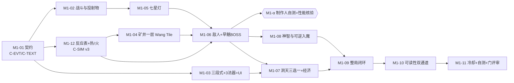

# 04 M1 计划：矿井一层完整可玩循环（MVP）

> **状态：生效（2026-11-20 已拍板）**｜制定与拍板：2026-11-20｜前提：用户拍板 M0 门以 **`conditional`** 放行，并对 §5 全部 5 项决策落定。
> **依据**：`docs/01-decision-twist.md`（D1–D5）、`docs/03-roadmap.md`（§3 依赖规则、§6 M1 粗拆）、`docs/tech/sim-fire-heat-design.md`、`refs/naming.md` §5、`data/biomes/level-01-coalmine.json`、`data/magic_numbers.json`。
> **M1 只回答一个问题**：**矿井 1 层好不好玩？**（灰盒美术，可读性靠颜色/音效/极简文字成立）

---

## 1. 范围边界与 Conditional 风险对策

### 1.1 做什么 / 不做什么（守死 D1–D5 红线）

| 做（M1 MVP 范围） | 明确不做（M2 之后 / EA 之后） |
|---|---|
| **深做三样（D1）**：`sim_core` 反应表与热/火（C-SIM v3）、8 条民俗物质反应、符箓三段式完整组装 + 3 种法器 | 阴面、纸扎、鬼市、祠堂怨灵、入魔深层内容（变异/阵营/结局）、双货币（冥钱） |
| **一层闭环**：矿井 1 层（**完整 Wang Tile 程序化拓扑 + 手工房间拼接**，D-M1-2 已定）+ 洞天（传法三选一 + 线性银两商店 + 安全区改符）+ 3 小怪 / 1 精英 / 旱魃 BOSS + 永久死亡重开 | 命格三选一（D5 推 EA 后）、按角色机制分化（D3 推 EA 后）、入魔「每 30s 失控 1s」与「魇烬」（D-M1-1 推后） |
| **薄系统**：七星灯（气血/熄灯双轴）、神智与可逆入魔（D3 精简 4 条，基础战斗成立后再加）、2–3 条规矩碑文/硬规矩（D2） | 像素刚体碎裂、多线程模拟、水墨后处理、存档（C-SAVE 留 M2）、Mod 接口、完整昼夜循环 |

### 1.2 M0 Conditional 遗留风险与内置止损

M0 跳过了「实验 A 目标机硬件复测」和「实验 C 外部 5 人盲测」，两项风险显式带入 M1 并设中途拦截点：

| 遗留风险 | M1 内止损动作 |
|---|---|
| **风险 A：目标机性能未实测** | `M1-12`（C-SIM v3）同步在 `sim_bench` 加「全屏燃烧」与「相机平移」压测；在 **M1-α（W5）** 结束前复测性能，若目标机超 D4 预算（6 ms / 2 ms），立即启用 2×2 粗格回退 |
| **风险 C：外部盲测延至 M2** | 按 D-M1-5，M1 退出门采用「制作人自测 + 自动化冒烟」；但仍保留 **M1-α（W6 末：反应表 + 投射物战斗 + 完整 Wang Tile 1 层 + 旱魃）** 制作人实机检视点，发现不好玩当场调整 |

---

## 2. M1 退出门（进入 M2 垂直切片的通过标准，已拍板 D-M1-5）

1. **完整单局闭环**：从开局 → 矿井探索/战斗 → 洞天（传法三选一 + 商店 + 改符）→ 旱魃 BOSS → 胜利/死亡重开，**15–25 分钟**可跑通，0 crash、0 阻断性地形卡死（Wang Tile 连通性由自动化校验兜底）。
2. **核心沙盒成立**：`data/materials.json` 的 **8 条反应**全部在实机可触发且满足 D1 可读性（至少 2 个表达通道）；旱魃 BOSS 可通过「葫芦取水 / 化水 / 阴气」机制化克制，而非纯数值站桩。
3. **契约与自动化冒烟全绿**：`tools/validate_data.py`（含 C-TEXT / 实体 / 法器校验）、`sim_core` ctest（含 30 条 VM 用例 + 8 条反应测试）与 Godot headless 整局冒烟全绿。
4. **制作人实机自测通过**（D-M1-5 已定；外部 5 人盲测后移至 M2 Demo 门）：制作人完整自测至少 2 局，确认核心战斗、符箓组装、Wang Tile 探索与反应因果「好玩、读得懂」。

---

## 3. 任务一览、周期与依赖

> 依赖规则沿用 `docs/03-roadmap.md` §3：只连产物文件；分 **硬 / 软 / 决策 / 门** 四类；固定时间、可变范围（因 D-M1-2 选完整 Wang Tile，预计 **11 周** = 10 周开发 + 1 周冷却；单任务超时则砍边缘内容不延期）。

| # | 任务 | 输入（读） | 输出（写） | 依赖 | 预计 | 周次 |
|---|---|---|---|---|---|---|
| **M1-01** | **契约冻结：C-EVT + C-TEXT** + 数据校验扩展 + `EventBus`/`TextDB` 骨架 | `docs/tech/m1-01-contracts-evt-text.md`、`refs/naming.md` §5 | 冻结版 `m1-01-contracts-evt-text.md`、`data/texts/zh-CN.json`、`tools/validate_data.py` 扩展、`game/scripts/{event_bus,text_db}.gd` | 已拍板（2026-11-20） | 0.5 周 | **W1（已完成）** |
| **M1-12** | **反应表 + 热/火（C-SIM v3）**：热源/邻域阈值/8 条民俗反应/`smoke`/`toxic_smoke`/`steam`/实体 `burning·wet·poison`/燃烧压测 | `data/materials.json`、`data/magic_numbers.json`、`docs/tech/sim-fire-heat-design.md`、C-EVT | `sim_core/`（C-SIM v3）、`sim_reactions` ctest、`sim_bench` `burn-worst`+`typical-pan`、`SimWorldNode` C-SIM v3 桥接、3 条实体标签反应 | **硬**：M1-01（D-M1-3 已定） | 2 周 | **W2–W3（已完成，8/8 反应全通）** |
| **M1-02** | **战斗与投射物框架**：真实投射物实体（飞行/穿透/碰撞/消费 T3 VM `on_hit`·`on_expire` 动作树 + 全 16 种 C-ACT）+ 伤害类型 + `weak_to` | C-VM/C-ACT、C-EVT、`data/talismans.json` | `game/scripts/combat/{combat_entity,projectile,combat_manager}.gd`、全 16 op 无 NOOP、headless 战斗回归 | **硬**：M1-01；**软**：M1-12 | 1.5 周 | **W2–W3（已完成）** |
| **M1-05** | **七星灯双轴**：100 气血 + 7 盏魄灯（阴伤熄灯 0.2–0.5 盏，每熄 1 盏上限 -1/7）+ 极简灯格 HUD | `data/magic_numbers.json`、S-0004、C-EVT | `game/scripts/vitals.gd`、`hud.gd` 气血+灯格同步 | **硬**：M1-02 | 0.5 周 | **W4（已完成）** |
| **M1-03** | **符箓三段式完整 + 3 种法器 + 洞天组装 UI**：真游标/成文与散符/牌堆编辑（洞天安全区可编，极简无合体名，D-M1-4 已定） | T3 VM、`data/talismans.json`、C-TEXT | `data/wands.json`（3 把法器）、`TalismanVMNode.cast_deck` 真牌堆接口、`game/scripts/{wand_manager,wand_ui}.gd` | **硬**：M1-01 | 1.5 周 | **W4–W5（已完成）** |
| **M1-04** | **矿井一层（完整 Wang Tile + 手工房间拼接）**：按 `level-01-coalmine.json` 实现 Wang Tile 像素地形生成 + 手工房间（水银池/瓦斯囊/BOSS 房）拼接 + 连通性校验 + 碑文规矩与 hazard | `data/biomes/level-01-coalmine.json`、`data/rooms/*.json`、C-TEXT、C-SIM v3 | `game/scripts/{wang_gen,stele,biome_hazards}.gd`、`data/rooms/room-boss-coalmine.json`、5-seed BFS 连通性自检 | **硬**：M1-12、M1-01（D-M1-2 已定） | 2.5–3 周 | **W4–W6（已完成）** |
| **M1-06** | **敌人与旱魃 BOSS**：3 小怪（矿鬼/土蝼/硫烟鬼火）+ 1 精英（画皮，HP 80–120）+ 旱魃 BOSS（HP 420，火抗、弱水/阴气） | `data/biomes/level-01-coalmine.json`、M1-02、M1-04、M1-12 | `data/entities/layer01.json`、`game/scripts/enemies/`、BOSS 战斗冒烟 | **硬**：M1-02、M1-04、M1-05、M1-12 | 1.5 周 | **W6–W7（已完成 → 到达 M1-α 检查点）** |
| **M1-07** | **洞天（传法三选一 + 商店与线性经济 + 改符安全区）**：承担 D5 三选一 + 银两掉落/商店（300 银基数）+ 补血/回神智/买符与法器 | `data/magic_numbers.json` economy、M1-03、C-TEXT | `data/hub_pool.json`、`game/scripts/hub/` | **硬**：M1-03、M1-06 | 1 周 | **W8** |
| **M1-08** | **神智与可逆入魔（D3 精简 4 条，D-M1-1 已定）**：四来源流失、三段阈值（66/33/0）、未知信息腐坏（`C-TEXT.corruptible`）、禁符五雷反噬「污」印、可逆入魔 4 条核心效果 | S-0004、`data/magic_numbers.json` sanity、C-EVT、C-TEXT、M1-06 | `game/scripts/sanity.gd`、幻觉/心魔敌人复用、入魔回归用例 | **硬**：M1-02、M1-06、M1-01 | 1 周 | **W8–W9** |
| **M1-09** | **整局闭环与死因回顾**：开局 → 矿井 → 洞天 → 旱魃 → 通关/永久死亡（显示死因与本局触发的反应知识，R 重开） | M1-04、M1-06、M1-07、M1-08、C-EVT | `game/scripts/run_manager.gd`、死因/通关界面、整局 headless 冒烟 | **硬**：M1-04、M1-07、M1-08 | 0.5 周 | **W9–W10** |
| **M1-10** | **可读性表达收尾**：消费 `C-EVT`，为 8 条反应/火/毒烟/熄灯/反噬补齐「颜色粒子 + 灰盒音效 + 极简提示」至少两通道（**反馈骨架已于 W6 提前落地**，见 `docs/tech/m1-feedback-juice.md`；W10 只剩 8 条反应的专属表现与 D1 核对表） | C-EVT、C-TEXT、M1-12、M1-08 | `game/scripts/feedback/`（粒子/程序化短音效/浮动短字）、D1 可读性核对表 | **硬**：C-EVT、M1-12、M1-08 | 0.5 周 | **W6（骨架）/ W10（收尾）** |
| **M1-11** | **冷却修 Bug + 制作人自测 + 自动化冒烟与 M1 门评审**（D-M1-5 已定） | 全部 M1 产物 | `docs/tech/m1-review-report.md`、性能补测记录、M2 工期重估 | **硬**：M1-09、M1-10；**决策**：你自测并评审开门 | 1 周 | **W11** |

### 关键路径

**关键路径**：`M1-01 → M1-12 → M1-04（Wang Tile）→ M1-06 → M1-08 → M1-09 → M1-11`（`M1-12` 与 `M1-04` 为两大技术风险项）。

---

## 4. M1-12（C-SIM v3）的 8 条反应落地清单

直接消费 `data/materials.json` 现有 8 条反应，不新增设计外反应：

| # | 反应 id | 触发与输入 | priority / consumes | M1-12 落地行为 |
|---|---|---|---|---|
| 1 | `r-black-powder` | `heat ≥ 120`：`saltpeter + sulfur + coal` | 10 / 全耗 | 爆炸（半径 40，伤 25，挖岩+点火+发 `reaction_triggered`） |
| 2 | `r-sulfur-toxic-smoke` | `heat ≥ 80`：`sulfur` | 1 / 不耗 | 生成 `toxic_smoke` 气体云（伤 3/s，毒，持续 5s；不耗硫，留给黑火药） |
| 3 | `r-bamboo-burn` | `heat ≥ 200`：`bamboo` | 0 / 耗 `bamboo` | 燃烧蔓延并产 `coal` + 少量 `smoke` |
| 4 | `r-lime-steam` | `contact`：`lime + water` | 0 / 全耗 | 生成高温 `steam` 气体云（半径 25，伤 5，可凝回少量水） |
| 5 | `r-rice-purify` | `contact`：`glutinous_rice + yin_qi` | 0 / 耗 `yin_qi` | 清除 `yin_qi`、保留糯米 |
| 6 | `r-dog-blood-spirit` | `contact`：`black_dog_blood` × `target_tags:[spirit]` | 0 / 耗血 | 对鬼/阴灵实体造成 20 阳伤 |
| 7 | `r-quicksilver-ward` | `contact`：`quicksilver` × `target_tags:[eldritch]` | 0 / 不耗 | 旧日/规则实体无法越过水银格边界 |
| 8 | `r-cinnabar-talisman` | `contact`：`cinnabar` × `target_tags:[paper]` | 0 / 耗朱砂 | 赋予玩家临时符位 +1（60s） |

> 另加 3 种底层引擎二级材质（`SIM_MAT_SMOKE`、`SIM_MAT_TOXIC_SMOKE`、`SIM_MAT_STEAM`，仅在 `c_sim.h` 末尾 append-only 追加，升级为 **C-SIM v3**，保留 v1/v2 全部 id 与 5 物质基准）。

---

## 5. 已拍板的 5 个 M1 计划决策（2026-11-20 用户全部落定）

| # | 决策项 | 拍板结论 | 落地位置 |
|---|---|---|---|
| **D-M1-1** | **入魔通用最小集**（D3 留到 M1 W1 定） | **精简 4 条**：① `<33` 幻觉变实、击杀 `+10` 神智；② 阴物中立；③ 禁符改熄 `0.5` 盏灯；④ 出魔留魔痕 `-10` 上限（最多 `-30`）。暂不做「每 30s 失控 1s」与「魇烬」 | `data/magic_numbers.json`（`sanity.possession`）、M1-08 |
| **D-M1-2** | **M1 矿井一层拓扑生成方式** | **M1 直接做完整 Wang Tile + 手工房间拼接**（工期按 +1.5–2 周计入，M1 总周期 11 周） | 对齐 `data/biomes/level-01-coalmine.json`、M1-04 |
| **D-M1-3** | **M1-12 火焰/热占位数值** | 按 `docs/tech/sim-fire-heat-design.md` 占位入 `data/materials.json` 与 `data/magic_numbers.json`（火 `heat=400`、`burning` 2%/s 5s、`wet` 5s、竹木/煤/硫各自 `burn_time` 与 `burn_product`） | `data/materials.json`、`data/magic_numbers.json`、M1-12 |
| **D-M1-4** | **M1-03 符箓组装 UI 交互** | **洞天安全区内**可编辑法器符位（无合体名，极简槽位栏） | M1-03、M1-07 |
| **D-M1-5** | **M1 退出门试玩标准** | **仅制作人自测 + 自动化冒烟**（外部 5 人试玩推迟到 M2 Demo 门） | 本文件 §2、M1-11 |

---

## 6. deviations

- **M0 门以 `conditional` 放行**：`docs/03-roadmap.md` §1 原要求 M0 三实验全达标才开 M1；2026-11-20 用户明确拍板按 `conditional` 跳过目标机复测与外部 5 人盲测，正式开启 M1。止损措施见 §1.2。
- **M1 退出门采用「仅制作人自测 + 自动化冒烟」（D-M1-5）**：偏离 `docs/03-roadmap.md` §1「M1 外部试玩多数人主动想再来一局」，把外部试玩统一后移到 M2 Demo 门；复议条件 = M1-α 自测发现方向分歧时随时提前拉外部玩家。
- **M1-10 反馈层骨架提前到 W6 落地**：打击感/射击爽感六层（火光、后坐、定向震屏、命中、击杀、分层音效）+ 本作专属的反应环与熄灯/反噬共 8 层，已作为 `game/scripts/feedback/` 交付（规范见 `docs/tech/m1-feedback-juice.md`）。偏离原排期的地方只在时间（W10 → W6 骨架 + W10 收尾），范围未变；代价 = 3 条表现层偏离（不做全屏强闪、顿帧用全局 `Engine.time_scale`、音效运行时合成），复议条件见规范文档 §4。
- **可逆入魔 M1 暂不做「每 30s 失控 1s」与「魇烬」（D-M1-1）**：偏离 S-0004 草案的 5 条全量；保留 4 条核心效果（心魔变实击杀回神智/阴物中立/禁符熄灯/魔痕），已写入 `data/magic_numbers.json` 的 `v1_deviations`，复议条件 = M1-08 实机自测后评估是否补回。

## 附录 A：工具链后续建议（2026-11-21，非 M1 任务、未排期）

> 来源：用户要求把 GitHub 游戏开发工具清单登记为「后续建议」。**本附录不改变 M1 范围、关键路径或门标准**；任何工具的实际引入（尤其会改依赖/CI/工程结构的）都需要用户拍板。完整清单与许可证说明见 [`docs/research/oss-gamedev-tools-2026-11.md`](../research/oss-gamedev-tools-2026-11.md)。

| 优先级 | 工具（★/许可） | 用途 | 建议评估时机 | 前置条件/风险 |
|---|---|---|---|---|
| 1 | [Coding-Solo/godot-mcp](https://github.com/Coding-Solo/godot-mcp)（6.7k/MIT） | MCP：AI 启动 Godot 编辑器/跑项目/抓调试输出/改场景 | M1-α 视觉/手感迭代前，做一次 1–2 小时小试验 | 需要 MCP 客户端配置；能启动引擎/读写项目，需限定项目目录与 allowlist |
| 2 | [jame581/GodotPrompter](https://github.com/jame581/GodotPrompter)（981/MIT） | 面向 AI coding agent 的 Godot 领域 skills（测试/CI/导出/LimboAI），支持 Antigravity | 同上，可作为 Antigravity 的 skills 补充 | 它的工作流未必匹配我们的契约/目录，需要裁剪后再用 |
| 3 | [Tracy](https://github.com/wolfpld/tracy)（17.2k/BSD-3）+ [nanobench](https://github.com/martinus/nanobench)（1.8k/MIT） | C-SIM/VM 帧级/微基准 profiling | D4 目标机到位前，先在开发机固定热点与基准 | Tracy 需带编译开关重编引擎；nanobench 可单头文件接入 |
| 4 | [LDtk](https://github.com/deepnight/ldtk)（5.0k/MIT） | 2D 关卡编辑器（JSON 输出） | M1-04 关卡迭代或 M2 内容加速 | 需要写 JSON → `data/rooms/` 的导入管线；LDtk 是工具，产出物许可自控 |
| 5 | [Pixelorama](https://github.com/Orama-Interactive/Pixelorama)（11.2k/MIT）+ [Material Maker](https://github.com/RodZill4/material-maker)（6.3k/MIT） | 像素美术与程序化材质 | M1-α 后做灰盒→美术时 | 工具 MIT；产出资产自行管理 |

**明确不同意的点**：不引入需要 Godot 4.7+ 的 `hi-godot/godot-ai`（我们当前 4.5）；不改 `.github/workflows`（deploy key 无 workflow scope，需用户本人操作）；不为了工具改已冻结契约。

