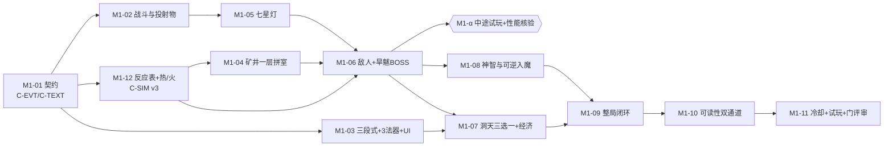

# 04 M1 计划：矿井一层完整可玩循环（MVP）

> **状态：草案（待用户审定）**｜制定：2026-11-20｜前提：用户拍板 M0 门以 **`conditional`** 放行，启动 M1 计划制定与 M1-01 契约起草（见 `docs/tech/m0-review-ledger.md`）。
> **依据**：`docs/01-decision-twist.md`（D1–D5）、`docs/03-roadmap.md`（§3 依赖规则、§6 M1 粗拆）、`docs/tech/sim-fire-heat-design.md`、`refs/naming.md` §5、`data/biomes/level-01-coalmine.json`、`data/magic_numbers.json`。
> **M1 只回答一个问题**：**矿井 1 层好不好玩？**（灰盒美术，可读性靠颜色/音效/极简文字成立）

---

## 1. 范围边界与 Conditional 风险对策

### 1.1 做什么 / 不做什么（守死 D1–D5 红线）

| 做（M1 MVP 范围） | 明确不做（M2 之后 / EA 之后） |
|---|---|
| **深做三样（D1）**：`sim_core` 反应表与热/火（C-SIM v3）、8 条民俗物质反应、符箓三段式完整组装 + 3 种法器 | 阴面、纸扎、鬼市、祠堂怨灵、入魔深层内容（变异/阵营/结局）、双货币（冥钱） |
| **一层闭环**：矿井 1 层（网格拼室 + 手工房）+ 洞天（传法三选一 + 线性银两商店）+ 3 小怪 / 1 精英 / 旱魃 BOSS + 永久死亡重开 | 命格三选一（D5 推 EA 后）、按角色机制分化（D3 推 EA 后）、完整 Wang Tile 美术拓扑 |
| **薄系统**：七星灯（气血/熄灯双轴）、神智与可逆入魔（D3，基础战斗成立后再加）、2–3 条规矩碑文/硬规矩（D2） | 像素刚体碎裂、多线程模拟、水墨后处理、存档（C-SAVE 留 M2）、Mod 接口、完整昼夜循环 |

### 1.2 M0 Conditional 遗留风险与内置止损

M0 跳过了「实验 A 目标机硬件复测」和「实验 C 外部 5 人盲测」，两项风险显式带入 M1 并设中途拦截点：

| 遗留风险 | M1 内止损动作 |
|---|---|
| **风险 A：目标机性能未实测** | `M1-12`（C-SIM v3）同步在 `sim_bench` 加「全屏燃烧」与「相机平移」压测；在 **M1-α（W4）** 结束前务必在目标级机器复测一次；若超 D4 预算（6 ms / 2 ms），立即启用 2×2 粗格回退，不拖到 M1 结尾 |
| **风险 C：外部盲测未做** | 不等到 W9 才给外人玩：**M1-α（W5 末：反应表 + 投射物战斗 + 1 层可打怪/打旱魃）** 立即做 2–3 人小规模盲测，验证核心战斗与沙盒因果是否好玩 |

---

## 2. M1 退出门（进入 M2 垂直切片的通过标准）

1. **完整单局闭环**：从开局 → 矿井探索/战斗 → 洞天（传法三选一 + 商店）→ 旱魃 BOSS → 胜利/死亡重开，**15–25 分钟**可跑通，0 crash、0 阻断性地形卡死。
2. **核心沙盒成立**：`data/materials.json` 的 **8 条反应**全部在实机可触发且满足 D1 可读性（至少 2 个表达通道）；旱魃 BOSS 可通过「葫芦取水 / 化水 / 阴气」机制化克制，而非纯数值站桩。
3. **契约与回归守护**：`tools/validate_data.py`（含 C-TEXT / 实体 / 法器校验）、`sim_core` ctest（含 30 条 VM 用例 + 8 条反应测试）与 Godot headless 冒烟脚本全绿。
4. **外部试玩指标**（待拍板 D-M1-5）：≥ 5 名外部试玩者中 **≥ 3 / 5 人**主动表示「想再来一局」，且死亡后能复述死因与至少一次符/物质组合因果。

---

## 3. 任务一览、周期与依赖

> 依赖规则沿用 `docs/03-roadmap.md` §3：只连产物文件；分 **硬 / 软 / 决策 / 门** 四类；固定时间、可变范围（预计 9 周 = 8 周开发 + 1 周冷却；若单任务超时，砍边缘内容不延期）。

| # | 任务 | 输入（读） | 输出（写） | 依赖 | 预计 | 周次 |
|---|---|---|---|---|---|---|
| **M1-01** | **契约冻结：C-EVT + C-TEXT** + 数据校验扩展 | `docs/tech/m1-01-contracts-evt-text.md`、`refs/naming.md` §5 | 冻结版 `m1-01-contracts-evt-text.md`、`data/texts/zh-CN.json`、`tools/validate_data.py` 扩展 | **决策**：你审本计划与 M1-01 草案 | 0.5 周 | **W1** |
| **M1-12** | **反应表 + 热/火（C-SIM v3）**：热源/邻域阈值/8 反应/`smoke`/`toxic_smoke`/`steam`/实体 `burning·wet`/燃烧压测 | `data/materials.json`、`docs/tech/sim-fire-heat-design.md`、C-EVT | `sim_core/`（C-SIM v3，版本号+1）、反应 ctest、`sim_bench` 全屏燃烧场景、更新 `SimWorldNode` | **硬**：M1-01；**决策**：燃烧数值占位（D-M1-3） | 2 周 | **W2–W3**（关键路径） |
| **M1-02** | **战斗与投射物框架**：真实投射物实体（飞行/穿透/碰撞/消费 T3 VM `on_hit`·`on_expire` 动作树）+ 伤害类型 + `weak_to` | C-VM/C-ACT、C-EVT、`data/talismans.json` | `game/scripts/combat/`（投射物/伤害/受击/状态组件）、无界面战斗回归 | **硬**：M1-01；**软**：M1-12（`burning`/`wet` 先按接口接入） | 1.5 周 | **W2–W3**（与 M1-12 并行） |
| **M1-05** | **七星灯双轴**：100 气血 + 7 盏魄灯（阴伤熄灯 0.2–0.5 盏，每熄 1 盏上限 -1/7）+ 极简灯格 HUD | `data/magic_numbers.json`、S-0004、C-EVT | `game/scripts/vitals.gd`、`hud.gd` 气血+灯格同步 | **硬**：M1-02 | 0.5 周 | **W4** |
| **M1-03** | **符箓三段式完整 + 3 种法器 + 组装 UI**：真游标/成文与散符/牌堆编辑（洞天可编，无合体名） | T3 VM、`data/talismans.json`、C-TEXT | `data/wands.json`（3 把法器）、`TalismanVMNode` 真牌堆接口、`game/scripts/wand_ui.gd` | **硬**：M1-01；**决策**：UI 方向（D-M1-4） | 1.5 周 | **W4–W5** |
| **M1-04** | **矿井一层组装**：网格拼室（起/水银池/瓦斯囊/过渡房/BOSS 房，固定种子）+ 碑文规矩（`no-open-flame` 真 + `do-not-call-return` 假）+ 塌方/水银禁回灵 hazard | `data/biomes/level-01-coalmine.json`、`data/rooms/*.json`、C-TEXT、C-SIM v3 | 新增 2 个过渡房 + `room-boss-coalmine.json`、`game/scripts/level_gen.gd`、`stele.gd` | **硬**：M1-12、M1-01；**决策**：拓扑方案（D-M1-2） | 1 周 | **W4–W5** |
| **M1-06** | **敌人与旱魃 BOSS**：3 小怪（矿鬼/土蝼/硫烟鬼火）+ 1 精英（画皮，HP 80–120）+ 旱魃 BOSS（HP 420，火抗、弱水/阴气） | `data/biomes/level-01-coalmine.json`、M1-02、M1-04、M1-12 | `data/entities/layer01.json`、`game/scripts/enemies/`、BOSS 战斗冒烟 | **硬**：M1-02、M1-04、M1-05、M1-12 | 1.5 周 | **W5–W6**（→ **M1-α 检查点**） |
| **M1-07** | **洞天（传法三选一 + 商店与线性经济）**：承担 D5 三选一 + 银两掉落/商店（300 银基数）+ 补血/回神智/买符与法器 | `data/magic_numbers.json` economy、M1-03、C-TEXT | `data/hub_pool.json`、`game/scripts/hub/` | **硬**：M1-03、M1-06 | 1 周 | **W7** |
| **M1-08** | **神智与可逆入魔（D3）**：四来源流失、三段阈值（66/33/0）、未知信息腐坏（遵循 `C-TEXT.corruptible`）、禁符五雷反噬「污」印、可逆入魔最小集 | S-0004、`data/magic_numbers.json` sanity、C-EVT、C-TEXT、M1-06 | `game/scripts/sanity.gd`、幻觉/心魔敌人复用、入魔回归用例 | **硬**：M1-02、M1-06、M1-01；**决策**：入魔最小集（D-M1-1） | 1 周 | **W7–W8** |
| **M1-09** | **整局闭环与死因回顾**：开局 → 矿井 → 洞天 → 旱魃 → 通关/永久死亡（显示死因与本局触发的反应知识，R 重开） | M1-04、M1-06、M1-07、M1-08、C-EVT | `game/scripts/run_manager.gd`、死因/通关界面、整局 headless 冒烟 | **硬**：M1-04、M1-07、M1-08 | 0.5 周 | **W8** |
| **M1-10** | **可读性表达收尾**：消费 `C-EVT`，为 8 条反应/火/毒烟/熄灯/反噬补齐「颜色粒子 + 灰盒音效 + 极简提示」至少两通道 | C-EVT、C-TEXT、M1-12、M1-08 | `game/scripts/feedback/`（粒子/程序化短音效/浮动短字）、D1 可读性核对表 | **硬**：C-EVT、M1-12、M1-08 | 0.5 周 | **W8** |
| **M1-11** | **冷却修 Bug + 外部试玩 + M1 门评审** | 全部 M1 产物 | `docs/tech/m1-playtest-report.md`、目标机性能补测报告、M2 工期重估 | **硬**：M1-09、M1-10；**决策**：你约试玩者与门评审 | 1 周 | **W9** |

### 关键路径

**关键路径**：`M1-01 → M1-12 → M1-06 → M1-08 → M1-09 → M1-11`（几乎无余量；`M1-12` 是技术风险最高项，必须最先动工）。

---

## 4. M1-12（C-SIM v3）的 8 条反应落地清单

直接消费 `data/materials.json` 现有 8 条反应，不新增设计外反应：

| # | 反应 id | 触发与输入 | priority / consumes | M1-12 落地行为 |
|---|---|---|---|---|
| 1 | `r-black-powder` | `heat ≥ 120`：`saltpeter + sulfur + coal` | 10 / 全耗 | 爆炸（半径 40，伤 25，挖岩+点火+发 `reaction_triggered`） |
| 2 | `r-sulfur-toxic-smoke` | `heat ≥ 80`：`sulfur` | 1 / 不耗 | 生成 `toxic_smoke` 气体云（伤 3/s，毒，持续 5s；不耗硫，留给黑火药） |
| 3 | `r-bamboo-burn` | `heat ≥ 200`：`bamboo` | 0 / 耗 `bamboo` | 燃烧蔓延并产 `coal` + 少量 `smoke` |
| 4 | `r-lime-steam` | `contact`：`lime + water` | 0 / 全耗 | 生成高温 `steam` 气体云（半径 25，伤 5，可凝回少量水） |
| 5 | `r-rice-purify` | `contact`：`glutinous_rice + yin_qi` | 0 / 耗 `yin_qi` | 清除 `yin_qi`、保留糯米 |
| 6 | `r-dog-blood-spirit` | `contact`：`black_dog_blood` × `target_tags:[spirit]` | 0 / 耗血 | 对鬼/阴灵实体造成 20 阳伤 |
| 7 | `r-quicksilver-ward` | `contact`：`quicksilver` × `target_tags:[eldritch]` | 0 / 不耗 | 旧日/规则实体无法越过水银格边界 |
| 8 | `r-cinnabar-talisman` | `contact`：`cinnabar` × `target_tags:[paper]` | 0 / 耗朱砂 | 赋予玩家临时符位 +1（60s） |

> 另加 3 种底层引擎二级材质（`SIM_MAT_SMOKE`、`SIM_MAT_TOXIC_SMOKE`、`SIM_MAT_STEAM`，仅在 `c_sim.h` 末尾 append-only 追加，升级为 **C-SIM v3**，保留 v1/v2 全部 id 与 5 物质基准）。

---

## 5. 需要你拍板的 5 个 M1 计划问题（W1 锁定，附推荐）

| # | 问题 | AI 推荐（默认值） | 备选 |
|---|---|---|---|
| **D-M1-1** | **入魔通用最小效果集**（D3 留到 M1 W1 定） | **精简 4 条**：① `<33` 幻觉变实、击杀 `+10` 神智；② 阴物中立；③ 禁符改熄 `0.5` 盏灯；④ 出魔留魔痕 `-10` 上限（最多 `-30`）。暂不做「每 30s 失控 1s」与「魇烬（依赖 v2 阴火）」 | 按 S-0004 草案全做 5 条（含每 30s 失控 1s + 魇烬掉落占位） |
| **D-M1-2** | **M1 矿井一层拓扑生成方式** | **网格拼室**（例如 4×2 房间格、固定种子随机抽房 + 连廊，必含水银池 / 瓦斯囊 / 洞天入口 / 旱魃 BOSS 房）；完整 Wang Tile 留 M2 | M1 就做完整 Wang Tile 像素地形生成（工期 +1.5–2 周） |
| **D-M1-3** | **M1-12 火焰/热占位数值** | 采用 `docs/tech/sim-fire-heat-design.md` 占位值（火 `heat=400`；`burning` 2% 最大生命/s、持续 5s；`wet` 5s 防点燃；竹木/煤/硫各自 `burn_time` 进 `data/materials.json`），进 `validate_data.py` | 另定数值或延迟调整 |
| **D-M1-4** | **M1-03 符箓组装 UI 交互** | **洞天安全区内**按 `I / Tab` 打开极简槽位栏，点击/拖拽调整法器上的符头/符胆/符脚顺序，全程只显示单卡名（沿用 `refs/naming.md` §5，不起合体名） | 随时随地可改符（降低洞天节点意义，更偏沙盒自由） |
| **D-M1-5** | **M1 退出门试玩标准** | ≥ 5 名外部玩家中 **≥ 3 / 5 人**跑完 15–25 分钟闭环、主动想再来一局，并能复述死因/组合因果 | 仅以制作人自测 + 自动化冒烟作为 M1 退出门 |

> 审完以上 5 条（以及配套的 `docs/tech/m1-01-contracts-evt-text.md` 草案）后，若按推荐全部拍板，我立刻冻结 **M1-01** 并并行开工 **M1-12（C-SIM v3）** 与 **M1-02（投射物/战斗框架）**。

---

## 6. deviations

- **M0 门以 `conditional` 放行**：`docs/03-roadmap.md` §1 原要求 M0 三实验全达标才开 M1；2026-11-20 用户明确拍板按 `conditional` 跳过目标机复测与外部 5 人盲测，直接启动 M1 计划与 M1-01 契约。止损措施见 §1.2（M1-α 中途性能核验与小规模试玩）。
- **M1-04 矿井拓扑建议先用网格拼室**：`data/biomes/level-01-coalmine.json` 写 `wang_tile + spliced`，若 D-M1-2 拍板先用网格拼室，届时同步写入 `level-01-coalmine.json` 的 `v1_deviations`，复议条件 = M2 垂直切片开工。
